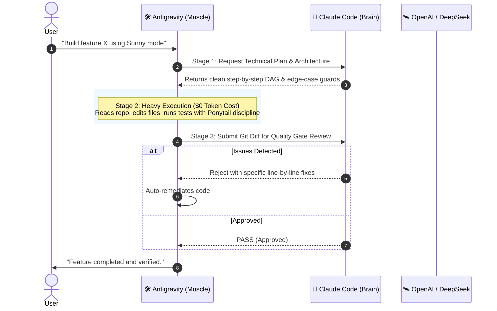

<div align="center">

# ☀️ Sunny
### The Brain & Muscle Multi-Agent Architecture for Antigravity & Claude Code

[](https://opensource.org/licenses/MIT)
[](https://www.python.org/downloads/)
[-4285F4.svg)](#)
[](#)
[](#)

*Stop burning expensive tokens on boilerplate. Stop letting low-tier models write buggy code.*  
**Sunny bridges Claude’s superior reasoning with Antigravity’s zero-token-cost execution.**

</div>

---

## 💡 The Problem with Modern AI Coding

| Approach | Strength | Fatal Flaw |
| :--- | :--- | :--- |
| **Using Claude Solo** | Unmatched architectural reasoning & code taste | Drains API budgets rapidly on boilerplate, search, and giant repository reads. |
| **Using Fast / Free Models Solo** | Unlimited tokens, fast execution | Can hallucinate, produce messy code ("AI Slop"), and miss subtle edge cases. |
| **☀️ Sunny Hybrid** | **Claude Plans & Reviews + Antigravity Executes** | **Best of both worlds: Elite code quality at ~90% lower token cost.** |

---

## 🏗️ Architecture: Brain & Muscle Loop



---

## ⚡ Key Highlights

### 1. 🧠 Claude as the Architect & Gatekeeper
Claude never writes boilerplate or modifies massive files directly. It spends only **500–1,000 tokens** per task to:
- Formulate the technical roadmap (Step-by-Step DAG).
- Audit the final `git diff` for security vulnerabilities, logic traps, and regressions.

### 2. 🛠️ Antigravity (Gemini) as the Muscle
Antigravity handles the heavy lifting inside your local workspace:
- Ingests massive repositories (up to 1M+ context window).
- Writes the implementation code, executes terminal commands, and runs test suites.
- Runs at **$0 token cost** via native Antigravity CLI quota.

### 3. 🧘 Ponytail Discipline (Zero AI Slop)
Both agents are governed by the **Ponytail** principle:
- The best code is the code never written.
- Always prefer the standard library over new third-party packages.
- Shortest working diff wins. No unnecessary wrappers, abstractions, or "code for the future".

### 4. 🛰️ Multi-Provider Extensibility
Beyond Claude, Sunny's universal bridge can seamlessly route specialized reasoning to:
- **OpenAI (o1 / o3-mini):** For deep mathematical proofs and rigid JSON parsing.
- **DeepSeek (R1):** For open-weight algorithmic complexity checks.
- **Ollama:** For 100% private, local offline execution.

---

## 🚀 Quickstart (1-Click Install)

### Prerequisites
- Python 3.10+
- [Antigravity CLI](https://antigravity.google) or IDE installed & logged in
- [Claude Code CLI](https://docs.anthropic.com/en/docs/agents-and-tools/claude-code/overview) installed & logged in

### Installation

#### Windows (PowerShell)
```powershell
git clone https://github.com/nttunggzzz/sunny.git
cd sunny
.\install.ps1
```

#### macOS / Linux (Bash)
```bash
git clone https://github.com/nttunggzzz/sunny.git
cd sunny
chmod +x install.sh
./install.sh
```

The installer will:
1. Initialize the Python virtual environment and install lightweight dependencies.
2. Register the `brain-muscle` and `ponytail` skills into your global Antigravity configuration directory (`~/.gemini/config/skills`).
3. Prepare a clean `.env` template.

---

## 🎮 How to Use

Once installed, you don't need to manually run scripts. Simply chat with Antigravity:

### Activate the Full Loop
> *"Implement user authentication for this FastAPI service. Use Sunny mode."*

Antigravity will automatically:
1. Ping Claude under the hood for a security-first execution plan.
2. Write the code adhering to Ponytail's minimal diff standard.
3. Submit the diff to Claude for review before declaring completion.

### Request Ad-hoc Review
> *"Review my recent git changes with Claude."*

### Consult Specialized AI
> *"Ask OpenAI o1 to verify this dynamic programming recurrence relation."*

---

## 🔒 Security & Privacy Guarantee

- **Zero Credential Persistence:** Sunny **never** hardcodes or commits API keys, tokens, or personal sessions.
- **Local-First CLI Communication:** Agents communicate via local process pipes and stdio without intermediary third-party servers.
- **No Telemetry:** Your code and logs stay strictly on your local disk in `logs/inter_agent_chat.jsonl`.

---

## 📁 Repository Structure

```text
sunny/
├── .gitignore               # Strict secret & log isolation
├── LICENSE                  # Permissive MIT License
├── README.md                # English documentation & guide
├── requirements.txt         # Minimal runtime dependencies
├── install.ps1              # 1-Click Windows installer
├── install.sh               # 1-Click macOS/Linux installer
├── .env.example             # Safe template with zero secrets
├── bridge/                  # Universal Inter-Agent CLI Bridge
│   ├── __init__.py
│   └── bridge.py            # Process orchestrator & router
└── skills/                  # Global Agent Skills
    ├── brain-muscle/        # Brain & Muscle protocol specification
    │   └── SKILL.md
    └── ponytail/            # Lazy Senior Developer code discipline
        └── SKILL.md
```

---

## 🤝 Contributing

Contributions, feedback, and pull requests are welcome! If you'd like to add support for new CLI tools or benchmark token savings, feel free to open an issue or PR.

---

## 📄 License

Distributed under the **MIT License**. See [LICENSE](LICENSE) for more information.

<div align="center">
  <sub>Built with ❤️ by Tung Nguyen (<a href="https://github.com/nttunggzzz">@nttunggzzz</a>) for the global AI developer community.</sub>
</div>
